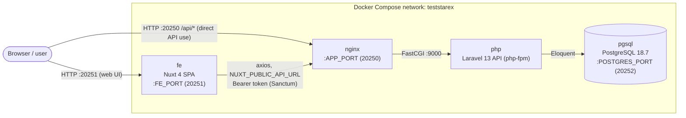
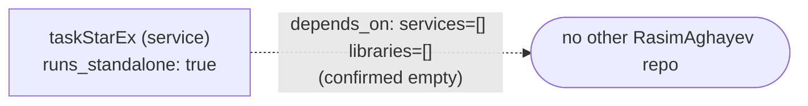
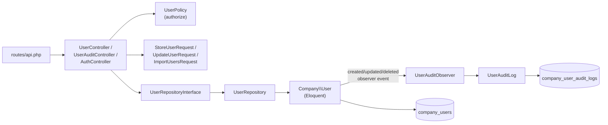
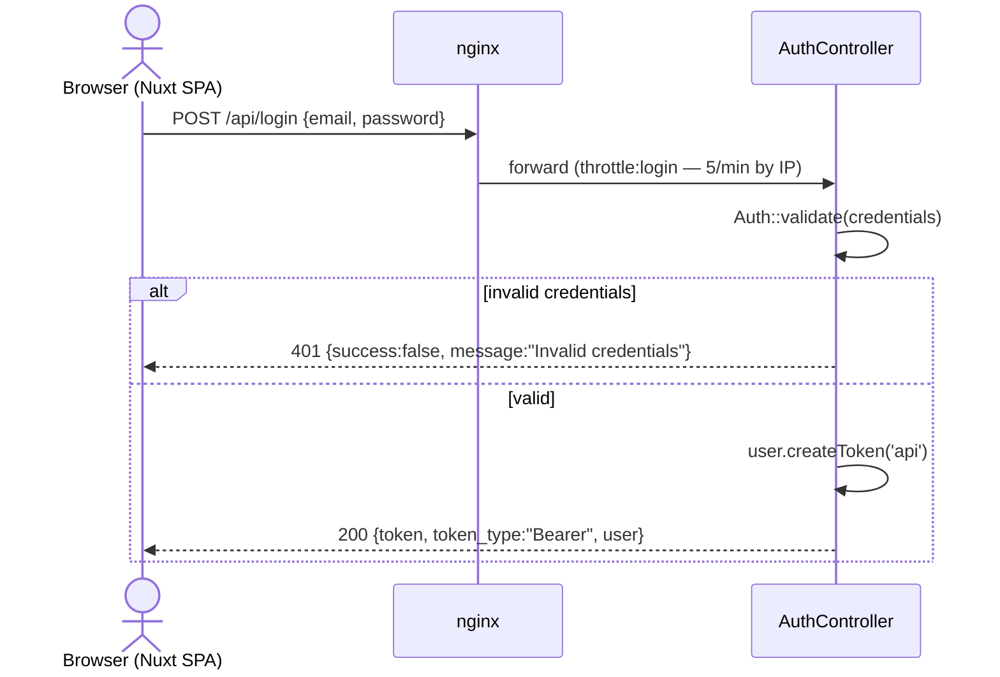
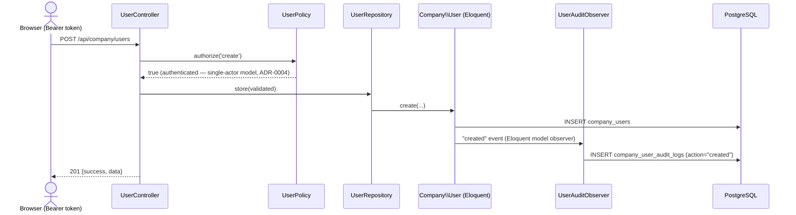
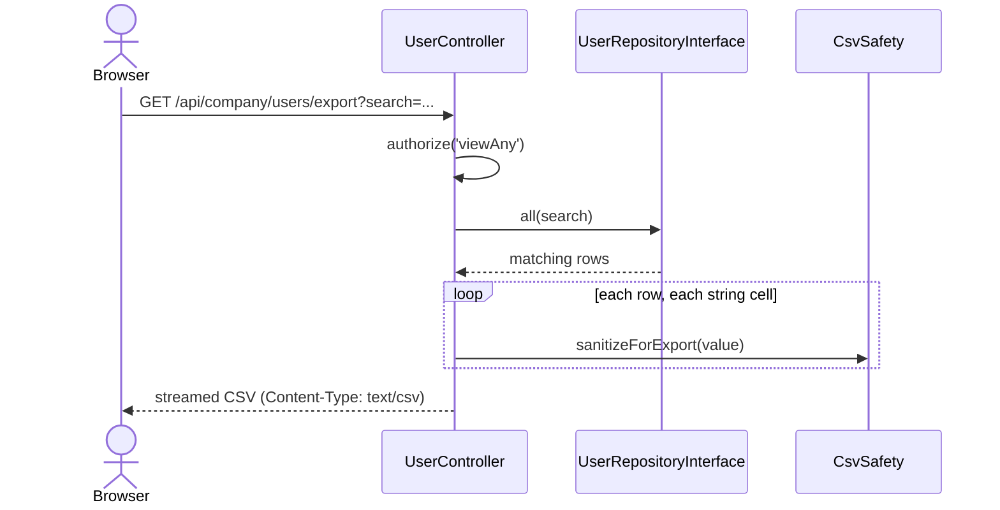
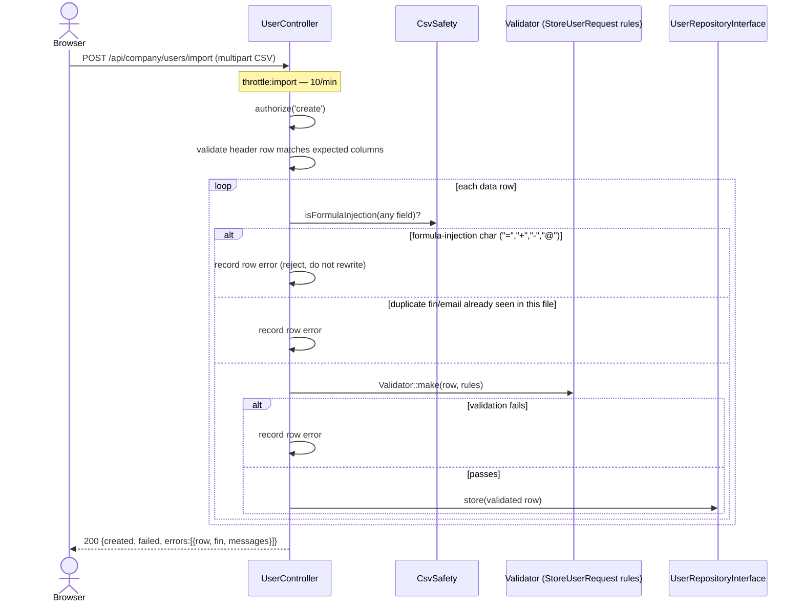
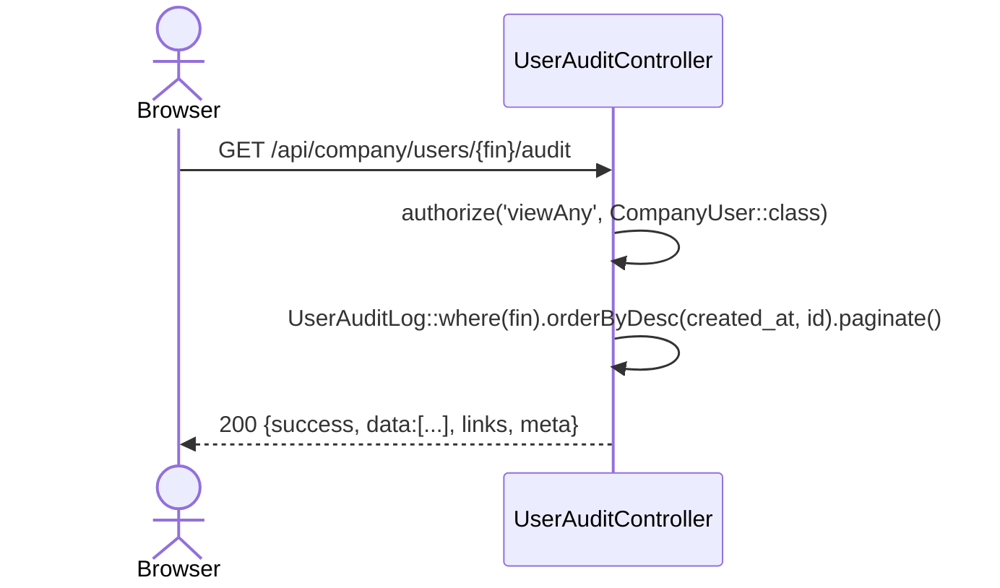
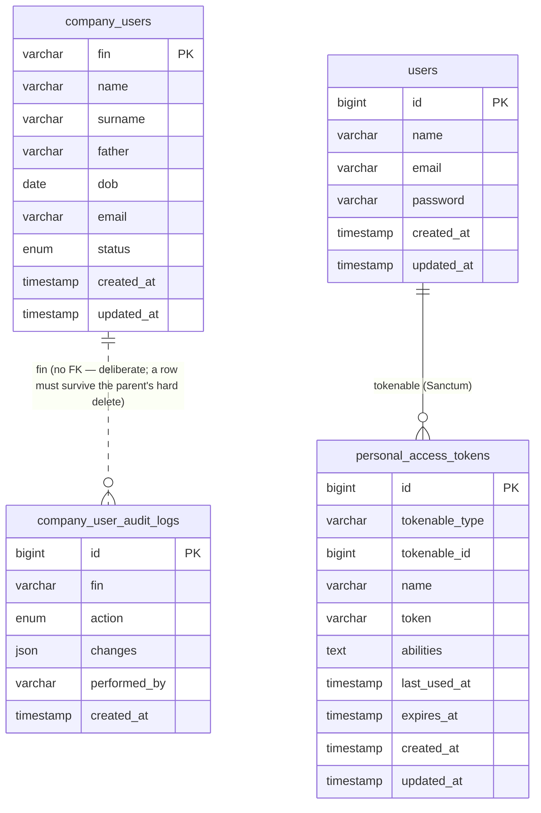
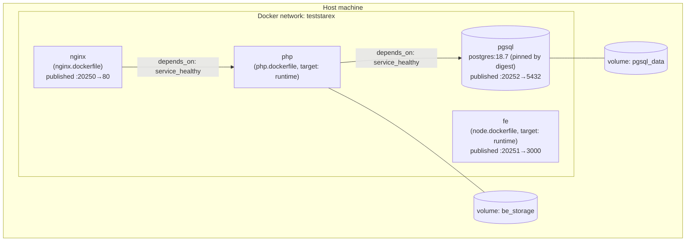

# Diagrams

> Phase 15. Every diagram below is derived directly from real code/config
> (cited next to each) — `docker-compose.yml`, `routes/api.php`,
> `bootstrap/app.php`, the controllers/observers/migrations, and this
> repo's own `repo-manifest.yaml`. Nothing is invented; anything not
> directly confirmed in code is marked **unconfirmed**. See
> `docs/ARCHITECTURE.md` for the prose version of most of this.

## 1. System context

Who/what talks to what, at the container level
(`docker-compose.yml`, `.env.example`):

`nginx`'s healthcheck dependency on `php` and the dev-only `php-dev`/
`fe-dev` tool-runner services (Compose `tools` profile) are omitted here
for clarity — see `docs/DEPLOYMENT.md` for the full service table.

## 2. Dependency chain (cross-repo ecosystem)

Per `repo-manifest.yaml` and `projects/info/DEPENDENCY_MAP.md` (Phase 2,
confirmed independently): **taskStarEx has zero dependencies on, and
zero dependents from, any other `RasimAghayev` repository.**

This is confirmed isolation, not an unchecked gap — both this repo's own
Phase 2 pass and the program-wide `DEPENDENCY_MAP.md` independently
reached the same conclusion.

For completeness, the real dependency chain that *does* exist is
internal (module-level, within this one repo):

## 3. Core flows

### 3.1 Login (token issuance)

`routes/api.php`, `AuthController::login`:

### 3.2 Company-user CRUD (create, with audit write)

`UserController::store`, `UserPolicy`, `UserRepository`,
`UserAuditObserver` — representative of create/update/delete, all of
which trigger the same observer-based audit write:

The audit write happens automatically via Laravel's model-observer
mechanism — `UserController`/`UserRepository` have no explicit
audit-logging call; `UserAuditObserver` is registered once on
`Company\User` in `AppServiceProvider::boot()`.

### 3.3 CSV export

`UserController::export`, `App\Support\Csv\CsvSafety`:

### 3.4 CSV bulk import

`UserController::import`, `ImportUsersRequest`, `CsvSafety`:

### 3.5 Audit-log read

`UserAuditController::index` — deliberately does not look up the parent
`company_users` row first, so history survives a hard delete:

## 4. Data model

From `database/migrations/*` (`company_users`, `company_user_audit_logs`,
`personal_access_tokens`, Laravel's default `users` migration):

Notes, all confirmed in code (none invented):

- `company_users.fin` is the primary key (not an auto-increment id) —
  a 7-character Azerbaijan-national-ID-style string.
- `company_user_audit_logs` has **no foreign key** to `company_users` by
  design (see the migration's own doc-comment) — append-only, must
  outlive the row it describes.
- `users`/`personal_access_tokens` are Laravel's/Sanctum's own tables.
  `users` was originally unused scaffolding (Phase 3 finding) but Phase
  9 wired real token authentication against it — it is genuinely live
  today, not dead code.
- `password_reset_tokens`, `sessions`, and Laravel's default
  cache/jobs tables also exist (from the same default migration) and
  remain unused — omitted above since nothing in this app's real flows
  touches them. There is **no `departments` table** — none exists in
  `database/migrations/`; confirmed by listing the directory, not
  assumed.

## 5. Deployment topology

Same services as §1, with build targets and persistent volumes
(`docker-compose.yml`, `*.dockerfile`):

Not shown (dev-only, not part of `docker compose up`): `php-dev`/`fe-dev`
tool-runner services under the Compose `tools` profile
(`docs/DEPLOYMENT.md`). There is no staging/production topology — this
*is* the only environment this repo has today.

## 6. Event flow

**N/A.** This repo has no event-driven architecture (standing decision 7
/ Phase 8's own EDA assessment: "no async reaction or cross-module/
cross-service integration exists or is planned"). The one
observer-pattern mechanism in this codebase (`UserAuditObserver`) is a
synchronous, in-process Eloquent model-event listener, not an async
event/message system — already shown as part of the core-flow diagram
in §3.2, not duplicated as a separate "event flow" diagram.
